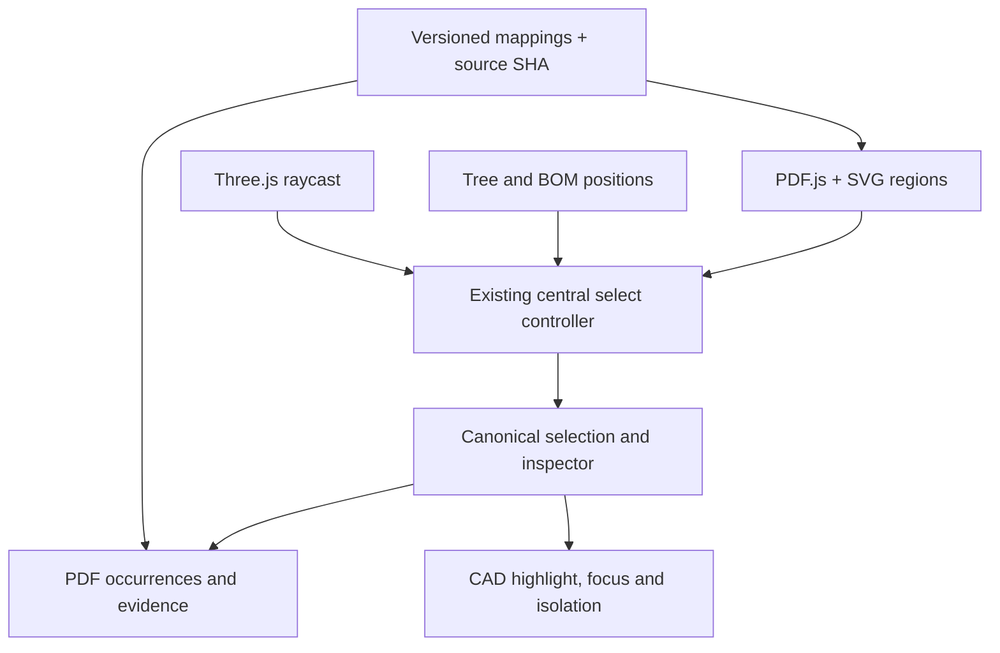

# M3 implementation and source review

Baseline: origin/main a94d51ff92c1283f56cd46a33b1905092d7008c7. Dedicated branch feature/m3-pdf-cad. No production deployment authorized by this M3 specification.

## Baseline audit

Read README, DESPIECES, VALIDACION, docs/AUDITORIA_TECNICA_2026-11-13 and docs/M2_INTERPRETACION_Y_SUBENSAMBLES. Live M2 inspected with browser: 76 CAD instances in C, component tree, fixed/moving branches, explosion, inspector. All 9 existing tests, TypeScript and Vite production build passed before changes. Existing package build hard-failed when optional outputs/A/B/C absent; staging now skips missing optional packages.

| Capability | M2 baseline | M3 branch |
|---|---|---|
| Original PDF inside workspace | No, raster preview only | PDF.js, local worker, actual original bytes |
| Persistent coordinates | One normalized image rectangle per instance | Multiple rect/polygon regions in unrotated PDF CropBox coordinates |
| Shared source mappings | 15 empty dictionaries | Version 2, hash-bound, 31 reviewed patches across all 15 sheets, plus one uncertain candidate |
| PDF / tree / CAD selection | Local rectangles and existing select callback | Shared select callback and selection state, canonical IDs, multi-instance highlighting |
| Authoring | Draw/replace rectangle | Polygon/rect creation, vertices, translation, review notes/status, undo/redo, import/export |
| Linked PDF download | Absent | Real Link/URI PDF annotations and deep-link study/part routing |
| Source identity | No document fingerprint | SHA-256, page boxes, rotation and page count manifest for all 15 PDFs |

## Architecture and paths

`src/pdf/workspace.ts` loads PDF.js, renders CropBox pages, handles high-DPI pixels independently from CSS dimensions, page navigation, zoom, fit, rotation and pan (Alt-drag, scrollbar, touch scroll, keyboard arrows). SVG overlays share the exact CSS viewport. `coordinates.mjs` maps normalized unrotated top-left CropBox coordinates, including 0/90/180/270 rotations and nonzero box origins. Original PDFs are never written.

`src/mapping/schema.mjs` is the schema validator, v1 migration and hit tester. V2 stores sheetId/sourcePdf/sourceSha256 and regions with studyId, canonical componentId, instanceIds, page, source view, geometry and evidence. Legacy image rectangles become pending_review, never verified automatically. Wrong document identity, coordinates, duplicate IDs, invalid pages and missing active-study CAD references are rejected. Empty/uncertain/rejected regions never become student click targets. Overlapping regions produce a chooser.

`src/sheet-link.ts` adapts existing `main.ts select` for document and tree selection. `sync/selection.mjs` stores the common identity and origins and validates deep links. `mapping/identity.mjs` distinguishes reusable geometry definitions from instances and BOM positions; modeled counts do not assert actual documented quantities. Existing OpenCascade generation and workers are unchanged. `viewport.ts` adds multi-instance highlighting and camera translation that preserves view orientation. Existing isolation, STEP/GLB exports and mechanical controls remain.

`src/pdf/linked-pdf.mjs` copies source pages with pdf-lib and adds Link annotations over verified patches. Rectangles are exact; polygon regions use conservative interior cell subdivision. Generated PDF points use bottom-left page coordinates. URLs resolve the current source study and instance. Browser exports never overwrite originals. `scripts/generate-linked-pdfs.mjs` creates reproducible examples; independent PyMuPDF validation reopened them and confirmed identical rendered page pixels and original dimensions.

`public/document-manifest.json` fingerprints all source PDFs. `public/mappings/*.json` are read-only published defaults. localStorage holds explicitly recoverable drafts only; drafts are never silently merged into shared data. Editor mode is opt-in, not authentication: static Pages cannot enforce instructor authorization. Repository review controls publication.

## Source review and coverage

280 and 281 inspected from original PDFs rendered at 2x, including enlarged disc-pack section. The 13 patches deliberately sit inside visible components, rather than pretending to segment entire bodies. They establish identity only, not manufacturing equivalence. C has five identified component identities, including two shaft occurrences; B four; 281 figure 2 three. Geometry and dimensions retain existing educational caveats. Narrow lining patches refer to equivalent modeled disc solids, not independently manufactured facings.

All 15 sheets were inspected at 2x from original PDF pages. Eighteen conservative patches extend source identity review to shafts, spindles, housings and the centrifugal drum. Twenty-one studies have at least one verified source identity; study 296-2 has only an uncertain candidate because the simplified model does not establish exact source variant correspondence. Remaining components are explicitly unresolved. `coverage.json` lists every modeled ID with its unresolved reason. The denominator of identifiable source components is not established: percentage is null, never modeled-instance-based. Every sheet is covered by the workflow; component-level mapping remains partial and no complete-coverage claim is made.

## Publication workflow

Export a mapping, review coordinates against original source and modeled identity, require notes for verified status, run npm run validate:mappings, npm test and npm run build, then commit public/mappings JSON on the feature branch. Original file replacement invalidates SHA-bound maps. Re-generate linked PDFs after approved mapping changes. No production branch merge or Pages deployment is performed here.

## Known limitations requiring further engineering

All 15 source PDFs are single-page scanned drawings. Thumbnails are therefore unnecessary; native page navigation supports multi-page inputs. Reference A has only an image, no original PDF. No OCR or automated mechanical recognition is claimed. Most library source correspondences, dimension-by-dimension evidence and exact group/BOM associations need further review. Polygon resizing is by vertex editing, not an independent bounding-box handle. Source view names are author supplied; no OCR labels are fabricated. The author can choose multiple existing instance IDs in the editor; the schema and viewport retain group highlighting and isolation. No native embedded 3D PDF is claimed; exported PDFs link to the web model. Deep links require this M3 branch to be merged/deployed before the public URL uses M3 routing. Tests from M2 cannot certify source dimensional equivalence or manufacturing validity.

## Selection and rendering topology

Parameter evidence retains the original EXPLICIT/ESTIMATED metadata, nominal values and edited values in the exported canonical inventory. These are assembly parameters, not automatically assigned manufacturing dimensions for every part. Bounds/volumes remain measurements of the generated solid. EXPLICIT nominal source values classify VERIFIED; raster estimates classify INFERRED; edited/adopted geometry classifies ILLUSTRATIVE; missing provenance classifies UNRESOLVED.
